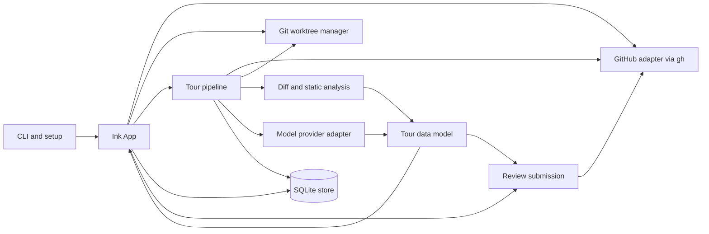

# Guided Review architecture

Guided Review is a Node.js terminal application that turns a GitHub pull request diff, or a local branch diff, into a navigable review tour. The tour is a plain data object built from static analysis and optionally enriched by a language model. An Ink interface presents it, while SQLite keeps reviewer activity across runs and GitHub receives reviews only when the user explicitly submits them.

This document describes the current source tree. For installation, commands, and keys from a reviewer's perspective, see the [documentation site](https://haydenmeloche.github.io/guided-review/) ([docs/usage.html](docs/usage.html)).

## System map

The important boundary is [`Tour`](src/types.ts): it contains files, hunks, chapters, graphs, test links, blast radius, and optional narration. Analysis produces and updates that object; the interface renders it. Reviewer choices such as read state and draft comments are stored separately and merged into the view.

## Repository layout

| Path | Responsibility |
| --- | --- |
| [`bin/gr.js`](bin/gr.js), [`src/cli.tsx`](src/cli.tsx) | Executable entry, commands, flags, target resolution, and Ink startup. |
| [`src/pipeline.ts`](src/pipeline.ts) | Coordinates diff processing, static analysis, model calls, caching, and re-review. |
| [`src/diff/`](src/diff/parse.ts) | Parses unified diffs into files, hunks, and line coordinates. |
| [`src/analysis/`](src/analysis/flows.ts) | Classifies changes; extracts symbols and flows; links tests; scores risk; finds review prompts and blast radius. |
| [`src/agent/`](src/agent/agent.ts) | Prompts, role routing, provider adapters, repository lookup tools, and Q&A. |
| [`src/git/`](src/git/worktree.ts) | The user's clones (`clones.ts`), cached clones, detached PR worktrees, cleanup, and Git reads. |
| [`src/github/`](src/github/gh.ts) | GitHub CLI and API reads and review-thread mutations. |
| [`src/store/`](src/store/db.ts) | SQLite tours and local review state. |
| [`src/tui/`](src/tui/App.tsx) | Ink screens, navigation, editing, diagrams, and interaction state. |
| [`src/tui/chapter/`](src/tui/chapter/layout.ts) | The chapter screen's parts: its source and test panes, layout plan, key table, selection and draft logic, and per-hunk view state. |
| [`src/tui/tutor/`](src/tui/tutor/Tutor.tsx) | The tutor (`gr tutor`) over the demo tour: its lessons as data, the script's pure steps, the anchors it points at, and the callout. |
| [`src/tui/author/`](src/tui/author/AuthorMode.tsx) | Author mode (`gr feedback`): the feedback briefing, the thread screen, and the send screen. |
| [`src/review/`](src/review/submit.ts) | Review payload construction, re-review comparison, the feedback model for author mode, and merge readiness. |
| [`src/diagram/`](src/diagram/text.ts) | Terminal and SVG rendering of the shared graph model. |
| [`src/config.ts`](src/config.ts), [`src/setup.ts`](src/setup.ts), [`src/detect.ts`](src/detect.ts) | User model settings, first-run setup, and repository rules. |
| [`test/`](test/) | Vitest tests for the parsers, analysis, providers, persistence, review payloads, and UI behavior. |

TypeScript compiles `src/` to `dist/` with NodeNext modules and React JSX. The published `gr` binary imports `dist/cli.js`; `pnpm dev` runs the TypeScript entry directly. `dist/` is build output, not the implementation source.

## Starting a review

[`src/cli.tsx`](src/cli.tsx) uses `meow` to handle `gr`, `gr review`, `gr feedback`, `gr preview`, `gr config` (alias `gr setup`), cleanup, `gr doctor` ([`doctor.ts`](src/doctor.ts): checks of git, gh, ripgrep, the model and the rest, each with its fix; its probes are passed in, so tests fake the machine), and command installers. A bare `gr` opens a picker of PRs requesting the viewer's review. A review target may be a PR number in the current repository, a GitHub PR URL, or `owner/repo#number`. `gr preview` constructs a synthetic PR numbered `0` from the current branch, its merge base with the repository's default branch, commit messages, and a local `git diff`; that diff includes uncommitted changes. `--base` names another branch to take the merge base with, and `gr diff` compares with a commit exactly (a `LocalTarget` parsed by `parseDiffTarget`); `gr diff a..b` compares two commits and reads the second from a detached worktree made by `commitWorktree`, named like a PR worktree numbered 0 so cleanup removes it. An empty comparison stops before the tour with a message. [`localPreview`](src/preview.ts) builds it, for the CLI and for `l` on the picker, and `App` reads it again on each load of a local tour, since the working tree changes. [`defaultBaseRef`](src/git/worktree.ts) names the default branch from `origin/HEAD`, then GitHub, then origin itself (`git ls-remote --symref`, non-interactive with a short timeout), preferring `origin/<name>` over the local branch. With no name, it takes `origin/main`, `origin/master`, local `main`, then local `master`. It deliberately ignores git's `init.defaultBranch`, which is the user's preference for new repositories, not the default of the repository they contribute to. `gr tutor` ([`demo.ts`](src/demo.ts)) writes a small sample repository to `~/.guided-review/demo` on each run, with fixed commit dates so its SHAs stay the same, and an `origin/HEAD` so the default branch needs no lookup, then opens it as a preview named `demo/shop` with the model off and without first-run setup. Its briefing and narration are written out in `demoNarration` and applied by the pipeline's `narrate` option through the same `applyBriefing` and `applyChapterResult` a model's answers go through. Each run starts over: App's store forgets the demo's tours, drafts and reading state (`forgetPR`) before it loads. Its submit screen shows the review but posts nothing. With no model, `a` answers from `DEMO_ANSWERS`, questions written about the demo's own lines (a test checks every `file:line` they cite against the demo's head), matched to a typed question by keyword and streamed in word by word through `AskOverlay`'s `prepared` prop. The tutor runs over it (see [The tutor](#the-tutor)).

For a GitHub PR, [`src/github/gh.ts`](src/github/gh.ts) gets metadata, commits, linked issues, and review context using `gh` GraphQL, REST, and CLI commands. [`src/git/worktree.ts`](src/git/worktree.ts) uses the clone gr runs in when one of its remotes is the PR repository, then the user's clone recorded in `~/.guided-review/clones.json` ([`clones.ts`](src/git/clones.ts): filled by setup's clones step, which scans folders, and by every run inside a repository, which records its main clone; an entry whose clone moved or whose remotes changed is dropped on use). Otherwise it creates a cached bare, blobless clone under `~/.guided-review/repos/`. It fetches the PR head and base from the matching remote as needed, then adds a detached worktree, without the repository's hooks or Git LFS downloads, under `~/.guided-review/worktrees/<repo>/pr-<number>-<head-prefix>`. The user's branch and working checkout are not switched. Each use marks the worktree (its folder's time) and the cached clone (a `gr-last-used` file). Cleanup removes registered managed worktrees, or for the automatic cleanup those unused for 3 days, and reports those Git refuses to remove, including dirty ones; a worktree whose repository is gone is deleted outright. Removing a PR's last worktree deletes its `refs/gr/pr-<n>` ref. It then prunes each cached clone's worktree list and deletes clones with no worktree left that no tour has used in 30 days, or that a recorded user clone has replaced.

`App` loads saved reviewer state, runs the pipeline, and opens the briefing on the first tour it emits: on a fresh build that is the static tour, and the model's briefing (summary, chapter titles, flow order) fills the screen in when it is written. Until then the briefing says it is being written, Q&A is on, and a chapter's guide says its narration is coming. The briefing reorders flow chapters, so the briefing's selection and the reader's position follow their chapter by ID. Chapter narration keeps arriving afterward. A generation counter prevents results from an older load from replacing a newer one. During a GitHub review, the app polls the PR head every 60 seconds and offers a rebuild when it changes.

## Tour construction

[`runPipeline`](src/pipeline.ts) first checks for a completed tour at the same repository, PR number, and head SHA. Reuse also requires the same `agentIdentity`, which records the effective provider, model, endpoint, and tool-calling choice for each model role. `--fresh` bypasses reuse. Even on a cache hit, the pipeline refetches current threads, submitted reviews, viewer identity, and mention candidates. Preview mode skips those GitHub reads and uses its supplied local diff.

On a cache miss for a GitHub PR, the pipeline first looks for a tour shared on the PR ([`sharedTour.ts`](src/github/sharedTour.ts)): a gzipped tour that `gr build --comment` ([`build.ts`](src/build.ts)) posted from CI as `github-actions[bot]`. Comments for another head are skipped by their first line before any data is decoded. The comment carries no code: a tour is used only when it is complete, built for the same head, and every file and hunk matches the reader's own diff (paths, headers, ranges and content hashes), and the reader then takes hunk lines from its diff and test and covered-code snippets from its checkout. The imported tour is saved with `source: 'shared'`, which `reuseLevel` treats as complete regardless of the reader's model routing. Per-reader fields (threads, reviews, viewer, re-review, sessions) are stripped before posting and recomputed on import.

Otherwise, [`buildStaticTour`](src/pipeline.ts) runs this sequence:

1. Parse the unified diff into `DiffFile` and `Hunk` records. Each line retains its old and/or new line number. A hunk ID hashes its path and diff header; a separate content hash hashes the path and changed lines without line numbers. The latter carries read state across line shifts and new heads. [`fuse.ts`](src/diff/fuse.ts) then joins hunks of a file that are at most six unchanged lines apart, reading the lines between them from the head and marking them `expanded`: they are not in GitHub's diff, so review placement never attaches a comment to them or lets a range cross them. A fused hunk keeps the content hash of each GitHub hunk it joins as its `parts`, and read state, moves and re-review go by those, so they hold when the same changes fuse differently on a later head. [`moves.ts`](src/diff/moves.ts) marks blocks removed in one place and added in another with where the other half is. A shared tour must match this same fused view of the reader's diff.
2. Read the PR head from the worktree and the base from the merge base of the PR's base and head SHAs. Classify each file as logic, test, config, mechanical, generated, or vendored. Repository rules and `.gitattributes` can influence classification. Detect generated-file or lockfile mismatches and isolate import-only hunks.
3. Build a symbol index from changed logic and test files. TypeScript and JavaScript use the TypeScript compiler API. Python, Go, Kotlin, C, C++, Java, Ruby, and Rust use tree-sitter WASMs when initialized. Other source files can fall back to regex extraction. Declarations, entry points, and calls are mapped to changed hunks.
4. Pair logic hunks with test cases using changed tests, symbol mentions, filename conventions, and optional coverage files. The reader sees a linked test's changed lines when that case changed in the PR. A test-only change may show its unchanged subject code. Coverage data comes from `coverage/coverage-final.json` or `coverage/lcov.info` in the checked-out tree.
5. Score risk from change content and path, clear import-only noise, and group hunks into chapters. Entry points such as routes, commands, handlers, components, and exported APIs seed flows. Flows are ranked by the amount of changed code they reach; a hunk is owned by one chapter and may be linked from another. Before flows are traced, [`special.ts`](src/analysis/special.ts) moves migrations, API contracts, dependency and runtime version changes, lockfiles, infrastructure, and CI files into their own chapters, so they are never pulled into a flow. Lockfile hunks join the dependencies chapter. A lockfile is paired with the changed manifests it locks ([`pairLockfiles`](src/analysis/lockfile.ts): the manifest in its own directory, else the nearest workspace lockfile above it; generated-file sync uses the same pairing for its stale-lockfile warning) and recorded in `Chapter.lockPairs`: each manifest dependency hunk is a page that lists the lockfile's package changes under its diff (the packages it names, then, on the pair's first page, the indirect rest), and the lockfile's hunks have no page of their own; marking the pair's last page read marks them too. A lockfile with no changed manifest is `folded`: the chapter opens on its summary (position `-1`, as a collapsed chapter does), and `n`/`p` step through the other hunks after it. Tours saved before pairing have every lockfile folded. Unreached logic goes into supporting changes. A changed type that a changed declaration names in any language joins the flow of that declaration, before its first use. A changed test file joins the flow whose code it tests, with the test file named for a changed file ranked first among its links; a test-kind file nothing links to, such as a fixture, follows the one flow whose tests name it. Test-only chapters follow, then the special chapters (migrations, API contracts, dependencies and runtimes, infrastructure, CI) and config, then the collapsed chapters: imports, mechanical, generated and vendored. If no entry point is found, logic uses file order.
6. Apply repository checklists, and search unchanged code for possible callers of changed public symbols, tables, and events. A PR with more than 5,000 changed lines of hand-written logic has supporting chapters split by directory.

The static flow graph is a reading aid. Calls are extracted syntactically, but changed call targets are matched by name; imports, receiver types, and scope are not fully resolved. Ambiguous targets are skipped. Test case name matches and filename matches yield `partial` coverage, while execution coverage is the evidence for `tested`. Missing-change and risk flags are prompts for inspection, not determinations that a PR is defective.

The resulting `Tour` starts in `plain` mode with a fallback intent drawn from the PR title, description, and linked issue titles. It already includes an overview graph, chapter diagrams where available, test links, and blast-radius references (uses of changed exports, tables and events in unchanged files), so a tour without a model (`--no-agent`, or `"provider": "none"` in the config) is a complete review path.

## Model enrichment

Unless disabled, the pipeline asks the `briefing` model for intent, chapter titles and summaries, a recommended flow order, and an optional overview graph. It saves that intermediate tour and calls `onTour` to update the screen the static tour opened. It then narrates flow, supporting, test, and special chapters with up to six chapters in progress at once. Special chapters use a prompt for their kind that asks what the change means (a migration's locks and data loss, whether an API change breaks clients, what an upgrade brings, what a workflow can now do) rather than what it edits, and their hunks are never folded into a shared minor-hunk summary. A chapter's folded lockfile hunks are their own batch, which sends the package changes parsed by [`lockfile.ts`](src/analysis/lockfile.ts) instead of the hunks, in one call, and the single summary is shared by every lockfile hunk. Each lockfile pair is a batch too: the manifest hunks rendered, and the lockfile's parsed changes split into direct and indirect, for one narration (and risk) shared by every hunk of the pair. Large chapters are divided into prompt batches. Per-chapter output can add hunk explanations, risk reasons, checklist pre-checks, and diagrams. Hunk IDs in prose are converted to file and line references; model graph edges and hunk references are checked against the tour.

[`src/agent/types.ts`](src/agent/types.ts) defines three independently configurable roles: `briefing`, `narration`, and `qa`. A role override that fails retries on the top-level provider and model. Transient rate-limit and server errors use bounded backoff, waiting a server's `retry-after` (up to 60s) when it gives one. If the briefing cannot run, the user gets the plain tour. A chapter failure leaves its static content and records a note; interrupted narration is rebuilt on a later open. `Tour.modelUsage` records which provider and model actually served each task, with its elapsed time, token counts, tool turns, and effort (the `ModelStamp` that `run()` builds from each adapter's usage); `GR_DEBUG_MODEL` logs the same per call ([`src/agent/debugLog.ts`](src/agent/debugLog.ts)).

Provider implementations are:

- Claude Code, Bedrock, and Vertex through the Claude Agent SDK in [`agent.ts`](src/agent/agent.ts). The SDK receives the worktree as its working directory and a guarded set of read-only `Read`, `Grep`, `Glob`, and constrained `Bash` commands. The policy in [`guard.ts`](src/agent/guard.ts) is enforced by a `PreToolUse` hook, which sees every tool call including ones the SDK auto-approves, with `canUseTool` as a second layer. Allowed Bash commands are rebuilt from their checked tokens, and `gh` is limited to the PR's repository.
- The Anthropic Messages API in [`anthropic.ts`](src/agent/anthropic.ts), through the Anthropic SDK with an API key. It streams every turn, offers the same `read_file`, `search_repo`, and `git_history` functions as the OpenAI adapters, and asks for JSON answers through the API's structured outputs (the schema as `output_config.format`, adapted by [`output.ts`](src/agent/output.ts)), so a briefing or narration cannot come back as malformed JSON.
- OpenAI Responses API in [`openaiResponses.ts`](src/agent/openaiResponses.ts). It uses `store: false`, supports streaming Q&A, and offers bounded `read_file`, `search_repo`, and `git_history` functions unless tool calling is disabled. JSON answers use strict structured outputs (`text.format`): strict mode needs every property required, so [`output.ts`](src/agent/output.ts) makes optional ones nullable and drops the nulls from the answer before it is checked.
- An OpenAI-compatible Chat Completions endpoint in [`openaiCompatible.ts`](src/agent/openaiCompatible.ts), with the same local lookup functions and optional streaming. Remote endpoints must use HTTPS; HTTP is allowed on localhost.

Provider output for briefing and narration is requested as structured JSON and validated before it is applied. Q&A is triggered from the UI, rather than being part of initial tour construction. Anthropic API, OpenAI, and compatible conversation histories are process-local; the tour stores their session IDs, but an in-memory conversation cannot be resumed after process exit. Claude Code session IDs can be resumed through the Agent SDK. The model lookup tools read repository content; posting a review is handled only by the review UI and GitHub adapter.

## Interface and reviewer state

[`App`](src/tui/App.tsx) owns the main phases: picker, loading, the "this is your PR" question, briefing, chapter, draft editing, submit, author mode, and error. A merge dialog ([`MergeScreen`](src/tui/MergeScreen.tsx)) and a checks popup ([`ChecksScreen`](src/tui/ChecksScreen.tsx)) open over the picker, the review briefing, or author mode. A reviewers popup ([`ReviewersScreen`](src/tui/ReviewersScreen.tsx)) opens over your own PR in the picker or the feedback briefing; it writes review requests to GitHub as you make them. The screen components handle local keyboard state and delegate durable changes back to `App`. [`nav.ts`](src/tui/nav.ts) derives Guided, Risk first, Small first, File, and Commit orders (Commit order's chapters come from [`commits.ts`](src/review/commits.ts): one `git log -p` of the tour's commits, each hunk matched by text to the commits that added or removed its lines, falling back to every commit that touched its file, and placed under the first), applies reviewer chapter moves, preserves the selected hunk when order changes, and computes progress. A new-head review can filter to only new or changed hunks without replacing the full saved tour.

[`ChapterScreen`](src/tui/ChapterScreen.tsx) combines hunk navigation with source and linked-test panes, raw diff, syntax highlighting, thread reading and replies, selection-based Q&A, history, checklist confirmation, and diagram navigation. It wires state to the pieces in [`src/tui/chapter/`](src/tui/chapter/layout.ts): [`chapterLayout`](src/tui/chapter/layout.ts) sizes everything for the terminal and view, and `overlaySlots` says where the open overlay mounts (an overlay with nowhere to go closes, since it would hold the keyboard with nothing on screen). [`keys.ts`](src/tui/chapter/keys.ts) defines every key once, driving the dispatch, the key bar, and the help popup; a test checks each key is in [docs/usage.html](docs/usage.html). [`selection.ts`](src/tui/chapter/selection.ts) turns a cursor and range into a draft anchor, and [`hunkView.ts`](src/tui/chapter/hunkView.ts) holds the cursor, range, expanded context, and test pane state, resetting them when the hunk changes. [`BriefingScreen`](src/tui/BriefingScreen.tsx) presents the overview and entry into chapters. [`SubmitScreen`](src/tui/SubmitScreen.tsx) shows drafts and a suggested verdict before posting. [`PickerScreen`](src/tui/PickerScreen.tsx) lists requested reviews, the PRs you reviewed that have changed since ([`listReviewedPRs`](src/github/gh.ts): commits after your latest review and replies on your open threads, up to 100 PRs with a note past that), and your own PRs, and loads a preview for the selected PR. [`DiagramView`](src/tui/DiagramView.tsx) uses the shared `Graph` model; [`src/diagram/`](src/diagram/text.ts) lays it out in the terminal or SVG.

Every screen describes its keys once. The chapter screen's table is [`chapter/keys.ts`](src/tui/chapter/keys.ts); the other screens use the `KeyDef` shape in [`keys.ts`](src/tui/keys.ts), in [`screenKeys.ts`](src/tui/screenKeys.ts) (the PR list, the review briefing, submit, merge, checks) and [`author/keys.ts`](src/tui/author/keys.ts). Each table feeds its key bar ([`KeyBar`](src/tui/KeyBar.tsx), which groups hints and ends in `+N more`), the shared help popup ([`Help`](src/tui/Help.tsx), grouped and scrollable, with the marks' legend from [`legend.ts`](src/tui/legend.ts)), and on the chapter screen and the briefing the command palette ([`CommandPalette`](src/tui/CommandPalette.tsx)); tests check every key a handler reads is in its table and in the docs. Esc closes the innermost thing and otherwise goes up a level, `q` goes up, and `Q` quits through `App`, which asks first when drafts or queued replies are unposted. While it asks, `KeysLive` in [`input.ts`](src/tui/input.ts) quiets every handler under the question, popups included; screens import `useInput` from there rather than from Ink. One-line messages go through [`flash.ts`](src/tui/flash.ts): info fades, warnings and errors stay until the next key, and a key with no action says so. [`breakpoints.ts`](src/tui/breakpoints.ts) names the widths every layout derives from, [`glyphs.ts`](src/tui/glyphs.ts) every mark (one cell wide, with an ASCII set), and [`TitleBar`](src/tui/TitleBar.tsx) the band at the top of each main screen.

Colors go through a theme. Screens import `Text` and `Box` from [`themed.tsx`](src/tui/themed.tsx) rather than from Ink. These pass the ANSI names the screens use (`cyan`, `red`, …) and the `surface:` names for popup and diff backgrounds through the current [`Palette`](src/tui/theme.ts), and give top-level text the theme's foreground. The default `terminal` palette maps every name to itself, so the terminal's own colors show; its popup and diff backgrounds are mixed from the terminal's background, which the CLI asks for at startup ([`terminalBackground.ts`](src/tui/terminalBackground.ts)). Below truecolor, `resolveColor` swaps mixed backgrounds for 256-color shades, and `NO_COLOR` drops colors in `themed.tsx`. `theme.ts` also writes down the color roles (cyan for what you can act on, the heading color for titles, magenta for the model) and `BORDER`, the border color for what a box is for. Any other palette is derived from a shiki theme. Each accent takes the theme's most used code color near its hue, or its terminal color when none is near. Dimmed text takes the comment color, the `role:` names for headings and titles take the heading and function-name colors, and `useSelected` marks a row with the selection background (inverting it with the terminal's colors). Every color is nudged to a minimum contrast. [`DiagramView`](src/tui/DiagramView.tsx) gives each character of a diagram a role from the renderer's box positions: frame or node text, with a changed box's in `role:changed-box` and `role:changed-text`, or arrow (`role:line`). `diagramColors` hands the same palette to the browser SVG. `Box` also gives its border the background behind it, which Ink would otherwise leave unpainted. `App` holds the palette above the screens and paints its background. Screens pass the palette's `syntax` theme to [`highlight.ts`](src/tui/highlight.ts) and the highlight cache, where it is part of every key. [`ThemePicker`](src/tui/ThemePicker.tsx) previews the theme the cursor rests on (`useThemePreview` in `themed.tsx`), over a tour (`L`) or as the first step of setup ([`SetupWizard`](src/tui/SetupWizard.tsx)).

The comment composer ([`CommentEditor`](src/tui/CommentEditor.tsx)) keeps its working state in a [`ComposerState`](src/tui/composer.ts) owned by whoever places it, so it can move from the inline slot under the code to a popup without losing text, cursor, or references. A `mode` decides which layer receives keys, because Ink calls every active input handler, and `layer` (shown as a chip on the composer's title) names the one that has them: text, the inline AI suggestion line ([`AiSuggestion`](src/tui/AiSuggestion.tsx), whose `ai` state also sizes the inline slot), or the posted-comment preview. [`references.ts`](src/tui/references.ts) builds `CodeRef`s from symbols, files, ranges, tests, callers, and threads, hashing referenced lines from the worktree through `safeReadFile`, and provides the composer's `@` completer: People rows (the mention candidates) come from its synchronous `instant`, so they show at once, and Code rows from an async search over [`RepoIndex`](src/analysis/repoIndex.ts); [`TextInput`](src/tui/TextInput.tsx) lists them under dim, unselectable group headers, with `searching…` in the Code group while it loads. A query holding characters no username can lists no people: the filters (`@f:`/`@files:`, `@s:`/`@symbols:`, `@callers:`, `@tests:`, `@threads:`, `@recent:`) and `@path:84-96`. The filters list the tour's blast radius for the anchored hunk (falling back to `RepoIndex.possibleCallers` for the declaration around the anchor), the hunk's linked tests, `existingThreads`, and recent locations; `references.ts` builds their rows and refs. Two or more letters of a filter's name add a Filters row whose `keepOpen` insert turns the query into the filter without closing the list. Under the list, `TextInput` draws the completer's `hint`: an actions line, and for the `@` completer a second line listing the filters (accented) or describing the active one; that line takes a row from the list, so an open list never grows the composer. Code rows carry a preview location; `TextInput` draws it through the host's `renderPreview` (a `SourcePreview`) and, when the completer has `pickLines`, lets the reviewer choose lines in it. A person inserts `@name `, code inserts its label as an inline code span. Thread replies keep a mentions-only completer. `App` holds a ring buffer of recent locations (cursor dwell, comments, questions, previews in the `@` list), and one `RepoIndex` per checkout and head; preview mode makes a fresh index per composer because the working tree can change. AI suggestions come from [`generateSuggestion`](src/agent/suggest.ts) on the Q&A routing without its session, are titled "proposal, not verified", and are saved only when the reviewer accepts them, with `suggestionMeta` recording the head and a hash of the replaced lines.

### The tutor

`gr tutor` runs lessons over the demo tour, in the spirit of `vimtutor`: every lesson uses the real screens and keys. The lessons are data in [`lessons.ts`](src/tui/tutor/lessons.ts): each starts at a place (the briefing, or the chapter holding a file, with the cursor on a line), and each step has text, what it points at, and what it waits for: `enter` (a read step), an event the screens report, or a state of the view. Text names actions, not letters (`{next}`), which resolve through the chapter key table, so a rebound key changes the text with it; `test/tutor.test.ts` checks every token, event, anchor and place against the key tables and a freshly built demo tour. [`engine.ts`](src/tui/tutor/engine.ts) holds the script's pure steps (next, back, where a step expects the reader, whether a step is done, whether the reader has left it), and [`useTutor`](src/tui/tutor/Tutor.tsx) the state, called from `App`, which renders its layer above the screens.

The screens only report, through [`TutorContext`](src/tui/tutor/bridge.ts): `ChapterScreen` sends each action its key table runs and its open overlay and test focus, `AskOverlay` an answer finishing, and `App` the phase, position and drafts. The tutor's one request back is to put the reader at a lesson's place: `App` resolves the place against its chapters, and the screen closes what is open and lands the cursor. On a read step the tutor turns `KeysLive` off, as the quit question does, and takes `enter`, `backspace`, `esc` on the welcome and `Q` itself; on a do step every key goes to the screen. A do step remembers where it began, and when the reader leaves (another chapter or screen) the callout offers the way back instead, or lets them look around with the way back in the palette. Its progress (the last lesson started, and whether it was finished or dismissed) is one row in the store's `tutor` table, apart from the demo's tour state.

Pointing needs no knowledge of layout in the screens. A screen wraps a region in [`<Anchor id>`](src/tui/tutor/anchors.tsx), which, only in the demo, measures where it landed with Ink's `measureElement` after each render and reports it. A read step dims the screen through the `Dimmed` context in `themed.tsx` (every themed `Text` under it renders dim, and drops bold, whose closing code would end the dim too), and the anchor it points at turns it off for its subtree. The callout floats beside the anchor with an arrow, or inside a large one at its bottom right; below 100 columns or 30 rows, and for steps over an open overlay, it docks as a strip. `KeyBar` inverts the key a do step asks for (moving it ahead of `+N more` when it would be hidden) and reports its column for the arrow. Outside the demo, `TutorContext` only carries the palette's way in: `: Tutor` (and `T` on the PR list) keeps the place it was started from, opens the demo, and returns there when the tutor ends.

Reviewer state is deliberately separate from the tour:

| State | Key and behavior |
| --- | --- |
| Read, skipped, or deferred hunk | Repository, PR, and hunk content hash (each part of a fused hunk, which is only as far along as its least reviewed part); `unread` is represented by no row. On a PR it is mirrored to GitHub's Viewed checkboxes a file at a time ([`viewed.ts`](src/review/viewed.ts)): files viewed there open as read, and a file read through here is ticked there, unless `syncViewed` is false. |
| Draft comment | Stable draft ID with a line, range, chapter, or diagram-node anchor; remains local until review submission. |
| Navigation position and order | Repository and PR, with chapter and optional hunk ID. |
| Moved hunk | Content hash to destination chapter ID. |
| Checklist confirmation | Checklist item ID per repository and PR. |

## Author mode

`gr feedback` (or `gr review` on your own PR, after it asks, or `Enter` under **Your PRs** in the picker) loads the PR as a review does, but takes any tour already saved for the head that has a briefing (or any at all without a model). Otherwise it runs the pipeline with `briefingOnly`: the static tour opens author mode at once, and with a model the briefing follows (summary and chapter titles), with no chapter narration. That tour is saved incomplete, so a later `gr review` narrates its chapters; a tour shared from CI is picked up as usual. [`AuthorMode`](src/tui/author/AuthorMode.tsx) then reads the live threads, reviews, issue comments, viewer, and [`fetchMergeStatus`](src/github/gh.ts), paints once those arrive, then reads the thread diffs (`diffsReady`; "since your last visit" waits for them), and owns the feedback briefing, the thread screen, and the send screen. The merge, checks and reviewers popups are built by [`prPopups.tsx`](src/tui/prPopups.tsx) for the picker, the review briefing, and these screens alike. Their keys are listed once in [`author/keys.ts`](src/tui/author/keys.ts), which builds the key bars; `test/author-keys.test.ts` checks every key a screen reads is listed and documented. [`listAuthoredPRs`](src/github/gh.ts) pages its search up to 200 PRs and reports `truncated`; thread counts from GraphQL's first 100 threads carry `unresolvedThreadsAtLeast` when there were more. Feedback is a view, never stored in the tour: threads change far more often than the head the tour is keyed by.

[`feedback.ts`](src/review/feedback.ts) is pure. `placeThread` puts each thread on a tour hunk: a current thread by its line, an outdated one by following `originalLine` from the thread's `originalCommit` to the head through the diff between them (`mapLine`, the same old-to-new walk as re-review's `changedSpans`), to the nearest surviving line when its lines were rewritten, or to the comment's own `diffHunk` when the line left the diff or the commit is gone. [`threadDiffs.ts`](src/review/threadDiffs.ts) reads those diffs, one per commit and path, fetching a missing commit first. The review tour uses the same placement (`placedThreads`) so its inline markers show outdated threads on their current line. `buildFeedback` adds each thread's state (open, replied, probably addressed, resolved), class (a `gr` label, else the model's, else change request), and the author's triage; `addressedReason` counts a changed span only when it is the PR's own (the span follows to an added line of a tour hunk, or the nearest line of one), so a base branch merge does not read as the author's fix. `groupFeedback` groups threads by the chapter that owns their hunk, hides only resolved threads, and sorts probably-addressed ones after the rest of their chapter, change requests first, then the tour's order. `sendPlan` orders a send: replies, then the conversation comment, then resolves, then the re-request. The conversation comment (which answers review summaries, quoted by `quoteReply`) is queued in the same table as replies under the thread id `CONVERSATION`, and posts through the issue comments endpoint (`postIssueComment`).

[`postThreadReplies`](src/github/gh.ts) batches queued replies into one pending review (`addPullRequestReview`, `addPullRequestReviewThreadReply`, `submitPullRequestReview` as a comment), if any step fails it deletes the pending review and falls back to replying one by one (reporting `fallbackReason`), except that a submit failure whose pending review can no longer be deleted means the review landed, so it throws `UncertainSendError` and nothing is re-sent; when the viewer already has a pending review of their own it throws `PendingReviewError` and sends nothing, since GitHub refuses REST replies and parks GraphQL ones in that review (checked live). A one-by-one failure throws `PartialSendError` carrying the thread ids that did post, which `SendScreen` dequeues. Model help is in [`agent/feedback.ts`](src/agent/feedback.ts): themes and classes on the `briefing` role, validated against the threads shown (as T1, T2, …); drafted replies and merge commit messages on the `qa` routing without its session, like AI suggestions. Prompts quote review text as untrusted. `o` shows the prompt from `handoffPrompt` and copies it for the author's own coding agent; gr starts no agent from author mode, since its PR worktree is a detached copy.

[`merge.ts`](src/review/merge.ts) turns a `MergeStatus` (GitHub's `mergeStateStatus`, review decision, required and optional checks, permissions, and allowed methods) into blockers and warnings. `mergePR` sends the head SHA the dialog read, so a later push makes GitHub refuse the merge. [`codeRefs.ts`](src/review/codeRefs.ts) finds code a review comment names without linking (class and function names, inline code, file names) and resolves exact matches through the same `RepoIndex` comment autocompletion uses, for the thread's file preview. [`checks.ts`](src/review/checks.ts) orders and labels the same status's checks, and parses a GitHub Actions job log (`fetchJobLog`) into steps, errors, and warnings, with timestamps and escape sequences removed.

## Persistence and re-review

[`Store`](src/store/db.ts) uses Node's `node:sqlite` in WAL mode at `~/.guided-review/gr.db` (or `$GR_HOME/gr.db`). It creates tables for tours, read states, drafts, positions, moves, checklist confirmations, and resumable agent sessions, and for author mode, thread triage, queued replies (one per thread, with whether to resolve after sending), the last visit, and the model's reading of the feedback (kept while the threads it read are unchanged). Tours are gzipped JSON snapshots keyed by repository, PR number, and head SHA; saving one prunes the PR's older tours in the same transaction. `gr cleanup` also deletes tours not opened in 90 days and the per-PR state of PRs left without a tour (unposted drafts excepted), then returns free pages with `incremental_vacuum`. [`autoCleanup`](src/cleanup.ts) runs the same cleanup with a 30-day cutoff as a tour starts, at most once a day, keeping worktrees used in the last 3 days, and records the time in `cleanup.json` once it ends, so a run cut short by gr exiting is retried on the next launch. `journal_size_limit` keeps the WAL from staying large after a tour rewrite. Read-state hashes survive line movement; chapter IDs are less stable, so a saved chapter position or move may need re-selection after a major rebuild. A stored tour does not replace live GitHub thread and review fetching.

When a new head arrives, [`attachReReview`](src/pipeline.ts) compares it with the latest saved earlier tour. [`computeReReview`](src/review/rereview.ts) identifies new or changed hunks by content hash and compares posted local drafts and the viewer's GitHub threads with the old-to-new diff. It reports a resolved thread, deleted file, or changed commented span as addressed for triage; that status does not prove the concern was fixed. If the previous commit is unavailable after a force push, the delta uses content hashes and notes that line-level diff comparison was unavailable. Drafts against vanished hunk IDs remain saved and are flagged.

## GitHub writes

Drafting and navigation are local. [`buildReviewPayload`](src/review/submit.ts) converts pending drafts to one GitHub review payload at the tour's head SHA. It validates line anchors against the current diff, moves an unavailable line comment to the nearest attachable line on the same side, or places it in the review body when no line is available. Range comments stay ranges only when both ends are in the same hunk. Chapter and diagram-node comments are included in the review summary and attached to an available changed line when possible. `suggestVerdict` proposes a verdict from blocking drafts, open questions, unread logic, and high-risk untested hunks; the reviewer can change it. [`SubmitScreen`](src/tui/SubmitScreen.tsx) posts only after its explicit confirmation, then marks drafts posted.

A draft's body references code as single-backtick inline code spans whose text is exactly a ref's label, outside fenced blocks: `name()` for a function, `file#Name` for another declaration, `file`, `file:84-96`, or `thread:file:12`, each disambiguated within the draft by file, then path, then a counter (labels hold no whitespace or backtick). Any other code span is ordinary code, so there is no "unresolved reference" to report. `Draft.refs` holds only their targets, each a [`CodeRef`](src/types.ts) pinned to a commit; saving a draft drops refs no span names. [`refs.ts`](src/review/refs.ts) builds SHA-pinned permalinks on the GitHub web host, unique labels, and the inline links `buildReviewPayload` puts in place of the spans (``[`label`](permalink)``; a thread's link is its discussion); nothing is appended to the prose, and a draft naming no ref posts byte for byte as before. A suggestion posts as plain code when it is on removed lines, was moved or split, or was written against an earlier head (`Draft.suggestionMeta`) unless the caller says its lines are unchanged. `listDrafts` drops malformed refs instead of failing. The submit screen posts, previews (`p`), and hints with one `suggestionStillApplies` that treats a suggestion as current when its anchored lines hash the same at the new head; each draft row's dim hint (`postingNote`) comes from a dry run of `buildReviewPayload` with those options and never blocks posting.

Replies and reactions on existing review threads in a review tour are direct GitHub writes initiated from the thread UI. Author mode queues replies locally and sends them from its send screen, resolves a thread with `Z` after a confirmation, and re-requests review with the REST `requested_reviewers` endpoint. Merging goes through the REST merge endpoint, and deleting a merged branch through the refs endpoint, both after the merge dialog's confirmation.

## Configuration and operating constraints

User model routing lives in `~/.guided-review/config.json` and is the only source for provider, models, endpoint, API key (`apiKey`, or the variable named by `apiKeyEnv`), and tool calling. Nothing is written implicitly: a missing or invalid config raises `UserConfigError`. When an interactive command starts with no config file (and without `--no-agent`), the CLI first runs setup and continues once it is saved; otherwise it tells the user to run `gr config`. Setup is the full-screen [`SetupWizard`](src/tui/SetupWizard.tsx): theme, provider, details, comments, GitHub, local clones ([`ClonesStep`](src/tui/ClonesStep.tsx), which scans the folder setup runs in and searches folders under home with Ctrl+R; what it finds is added to `clones.json` on save; `gr config --clones` runs it alone through `runClonesSetup`), finish. The first time a PR comes from gr's own clone rather than the user's (`ensureWorktree`'s `onOwnCopy`, which also says when that clone must be downloaded), App shows the `clones` tip once, under the loading steps and then on the briefing until a key is pressed (the PR list's background checkouts don't use it up); every download of gr's own clone also shows it under the loading steps, and `gr doctor` suggests the scan once gr's own clones pass 100 MB. [`detect.ts`](src/detect.ts) finds providers that are ready (a Codex login, key variables, Ollama or LM Studio on localhost, Bedrock or Vertex switches) and whether `gh` is signed in, and [`check.ts`](src/agent/check.ts) sends one structured request to each distinct model before saving. The answer handling (defaults, validation, building the config) is plain functions in [`setup.ts`](src/setup.ts), which also keeps settings setup doesn't ask about, such as the chapter order. The `codex` provider ([`codex.ts`](src/agent/codex.ts)) shells out to `codex exec --json` under a generated permission profile (read access to the worktree, its git directories, the Codex install, and developer-tool paths; no home directory, writes, or network) with the user's Codex config ignored, reusing the Codex CLI login; Q&A sessions resume via `codex exec resume`. Effort and `fastMode` go as `-c` overrides, and a JSON answer's schema as a temporary `--output-schema` file in the same strict form as the OpenAI provider's. The `cursor` provider ([`cursor.ts`](src/agent/cursor.ts)) runs a local Cursor SDK agent in-process with every built-in tool disabled and no on-disk `.cursor` settings; its only tools are the worktree-confined `read_file`/`search_repo`/`git_history` from [`openaiCompatible.ts`](src/agent/openaiCompatible.ts), registered as SDK custom tools, and Q&A resumes via `Agent.resume`. `"provider": "none"` chooses no model: `agentRouting` then returns no routing, and every tour is built as with `--no-agent`. The model fields stay in the file for `lastProvider` (`keptRouting`), so `gr config` can start from them again, and `gr build` refuses to run without a model. CLI flags control only agent use (`--no-agent`, which needs no config) and cache reuse (`--fresh`). Team rules live in `<repo>/.guided-review.json`, read from the PR's merge base so a PR cannot change its own rules, and specify file-kind overrides, extra test globs, and checklist items matched by path. See [`config.ts`](src/config.ts) for parsing and defaults.

The app requires Node 22.13 or newer and an interactive terminal. GitHub review mode also needs `git` and an authenticated `gh` CLI. The worktree makes static reads against the PR head, through a reader that accepts only regular files inside the worktree up to a size cap ([`safeRead.ts`](src/analysis/safeRead.ts)); preview reads the current checkout and its local diff. Analysis and model tools do not run tests or alter the target repository. Coverage is consumed only if an existing coverage artifact is present. The review UI writes local state as the user works, while network writes require the relevant submit, reply, or reaction action.

## Development guide

Run `pnpm install`, then `pnpm typecheck`, `pnpm test`, and `pnpm build`. The most useful change boundaries are:

- Add a language or improve flow recognition in [`symbols.ts`](src/analysis/symbols.ts) or [`treesitter.ts`](src/analysis/treesitter.ts), then check how [`flows.ts`](src/analysis/flows.ts) groups its hunks.
- Adjust classification, risk, or test evidence in [`kinds.ts`](src/analysis/kinds.ts), [`risk.ts`](src/analysis/risk.ts), or [`tests.ts`](src/analysis/tests.ts); keep confidence claims aligned with the evidence available.
- Add model output by changing the prompt and schema in [`agent.ts`](src/agent/agent.ts) and [`prompts.ts`](src/agent/prompts.ts), then applying it in [`pipeline.ts`](src/pipeline.ts). The `Tour` type is the contract for all renderers and saved snapshots.
- Change reviewer interactions in the relevant `src/tui/` screen and wire durable state through `App` and `Store`. Pass any text that comes from GitHub or a model through [`sanitizeTerminal`](src/util/sanitize.ts) (or `renderMarkdown`, which does it for you) before it reaches `<Text>`. Change GitHub review placement in [`submit.ts`](src/review/submit.ts).

Tests in `test/` exercise these pieces without requiring a live PR. [`tour-corpus.test.ts`](test/tour-corpus.test.ts) tours the sample PRs in `test/fixtures/prs/` with no model and compares the shape of each tour (files, hunks, fusing, moves, chapters, flags) with a saved `.tour.txt`: a change to how PRs split shows up as a diff of those files, accepted with `pnpm test -u`. `make-sample.ts` there turns two commits into a new sample. [`scripts/backtest-chapters.ts`](scripts/backtest-chapters.ts) (`pnpm backtest`) applies the same summary to every PR saved in the dev database, rebuilding each static tour from its cached repository, so a chapter change can be compared across real PRs before and after. The end-to-end tests in `test/e2e/` run the built `gr` against a throwaway git repo. Each test gets its own `GR_HOME` and `HOME`, plus a fake `gh` on `PATH` that logs its arguments and fails. They read the screen through a headless xterm, so assertions match what a user sees, and need no network access or model. [`screens.e2e.test.ts`](test/e2e/screens.e2e.test.ts) walks a preview of a richer fixture repo at three terminal sizes and compares each screen, colors and styles marked up, with a file in `test/e2e/__screens__/`: a change to how a screen looks shows up as a diff of those files, accepted with `pnpm test:e2e -u`. For manual end-to-end work, `pnpm dev review <number>` uses the TypeScript entry, and `pnpm dev preview` uses the current branch.
