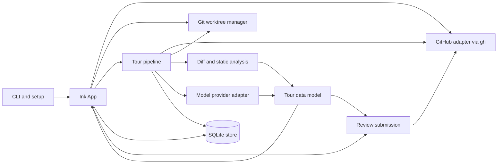

# Guided Review architecture

Guided Review is a Node.js terminal application that turns a GitHub pull request diff, or a local branch diff, into a navigable review tour. The tour is a plain data object built from static analysis and optionally enriched by a language model. An Ink interface presents it, while SQLite keeps reviewer activity across runs and GitHub receives reviews only when the user explicitly submits them.

This document describes the current source tree. For installation, commands, and keys from a reviewer's perspective, see [README.md](README.md) and [docs/usage.md](docs/usage.md).

## System map

The important boundary is [`Tour`](src/types.ts): it contains files, hunks, chapters, graphs, flags, test links, and optional narration. Analysis produces and updates that object; the interface renders it. Reviewer choices such as read state and draft comments are stored separately and merged into the view.

## Repository layout

| Path | Responsibility |
| --- | --- |
| [`bin/gr.js`](bin/gr.js), [`src/cli.tsx`](src/cli.tsx) | Executable entry, commands, flags, target resolution, and Ink startup. |
| [`src/pipeline.ts`](src/pipeline.ts) | Coordinates diff processing, static analysis, model calls, caching, and re-review. |
| [`src/diff/`](src/diff/parse.ts) | Parses unified diffs into files, hunks, and line coordinates. |
| [`src/analysis/`](src/analysis/flows.ts) | Classifies changes; extracts symbols and flows; links tests; scores risk; finds review prompts and blast radius. |
| [`src/agent/`](src/agent/agent.ts) | Prompts, role routing, provider adapters, repository lookup tools, and Q&A. |
| [`src/git/`](src/git/worktree.ts) | Cached clones, detached PR worktrees, cleanup, and Git reads. |
| [`src/github/`](src/github/gh.ts) | GitHub CLI and API reads and review-thread mutations. |
| [`src/store/`](src/store/db.ts) | SQLite tours and local review state. |
| [`src/tui/`](src/tui/App.tsx) | Ink screens, navigation, editing, diagrams, and interaction state. |
| [`src/review/`](src/review/submit.ts) | Review payload construction and re-review comparison. |
| [`src/diagram/`](src/diagram/text.ts) | Terminal and SVG rendering of the shared graph model. |
| [`src/config.ts`](src/config.ts), [`src/setup.ts`](src/setup.ts) | User model settings and repository rules. |
| [`test/`](test/) | Vitest tests for the parsers, analysis, providers, persistence, review payloads, and UI behavior. |

TypeScript compiles `src/` to `dist/` with NodeNext modules and React JSX. The published `gr` binary imports `dist/cli.js`; `pnpm dev` runs the TypeScript entry directly. `dist/` is build output, not the implementation source.

## Starting a review

[`src/cli.tsx`](src/cli.tsx) uses `meow` to handle `gr`, `gr review`, `gr preview`, `gr config` (alias `gr setup`), cleanup, and command installers. A bare `gr` opens a picker of PRs requesting the viewer's review. A review target may be a PR number in the current repository, a GitHub PR URL, or `owner/repo#number`. `gr preview` constructs a synthetic PR numbered `0` from the current branch, its merge base with the repository's default branch, commit messages, and a local `git diff`; that diff includes uncommitted changes. [`defaultBaseRef`](src/git/worktree.ts) names the default branch from `origin/HEAD`, then GitHub, then origin itself (`git ls-remote --symref`, non-interactive with a short timeout), preferring `origin/<name>` over the local branch. With no name, it takes `origin/main`, `origin/master`, local `main`, then local `master`. It deliberately ignores git's `init.defaultBranch`, which is the user's preference for new repositories, not the default of the repository they contribute to.

For a GitHub PR, [`src/github/gh.ts`](src/github/gh.ts) gets metadata, commits, linked issues, and review context using `gh` GraphQL, REST, and CLI commands. [`src/git/worktree.ts`](src/git/worktree.ts) uses the user's clone when its origin matches the PR repository. Otherwise it creates a cached bare, blobless clone under `~/.guided-review/repos/`. It fetches the PR head and base as needed, then adds a detached worktree under `~/.guided-review/worktrees/<repo>/pr-<number>-<head-prefix>`. The user's branch and working checkout are not switched. Cleanup removes registered managed worktrees and reports those Git refuses to remove, including dirty ones.

`App` loads saved reviewer state, runs the pipeline, and opens the briefing as soon as the agent briefing is ready. Chapter narration may keep arriving afterward. A generation counter prevents results from an older load from replacing a newer one. During a GitHub review, the app polls the PR head every 60 seconds and offers a rebuild when it changes.

## Tour construction

[`runPipeline`](src/pipeline.ts) first checks for a completed tour at the same repository, PR number, and head SHA. Reuse also requires the same `agentIdentity`, which records the effective provider, model, endpoint, and tool-calling choice for each model role. `--fresh` bypasses reuse. Even on a cache hit, the pipeline refetches current threads, submitted reviews, viewer identity, and mention candidates. Preview mode skips those GitHub reads and uses its supplied local diff.

On a cache miss for a GitHub PR, the pipeline first looks for a tour shared on the PR ([`sharedTour.ts`](src/github/sharedTour.ts)): a gzipped tour that `gr build --comment` ([`build.ts`](src/build.ts)) posted from CI as `github-actions[bot]`. Comments for another head are skipped by their first line before any data is decoded. The comment carries no code: a tour is used only when it is complete, built for the same head, and every file and hunk matches the reader's own diff (paths, headers, ranges and content hashes), and the reader then takes hunk lines from its diff and test and covered-code snippets from its checkout. The imported tour is saved with `source: 'shared'`, which `reuseLevel` treats as complete regardless of the reader's model routing. Per-reader fields (threads, reviews, viewer, re-review, sessions) are stripped before posting and recomputed on import.

Otherwise, [`buildStaticTour`](src/pipeline.ts) runs this sequence:

1. Parse the unified diff into `DiffFile` and `Hunk` records. Each line retains its old and/or new line number. A hunk ID hashes its path and diff header; a separate content hash hashes the path and changed lines without line numbers. The latter carries read state across line shifts and new heads. [`fuse.ts`](src/diff/fuse.ts) then joins hunks of a file that are at most six unchanged lines apart, reading the lines between them from the head and marking them `expanded`: they are not in GitHub's diff, so review placement never attaches a comment to them or lets a range cross them. A fused hunk keeps the content hash of each GitHub hunk it joins as its `parts`, and read state, moves and re-review go by those, so they hold when the same changes fuse differently on a later head. [`moves.ts`](src/diff/moves.ts) marks blocks removed in one place and added in another with where the other half is. A shared tour must match this same fused view of the reader's diff.
2. Read the PR head from the worktree and the base from the merge base of the PR's base and head SHAs. Classify each file as logic, test, config, mechanical, generated, or vendored. Repository rules and `.gitattributes` can influence classification. Detect generated-file or lockfile mismatches and isolate import-only hunks.
3. Build a symbol index from changed logic and test files. TypeScript and JavaScript use the TypeScript compiler API. Python, Go, Kotlin, C, C++, Java, Ruby, and Rust use tree-sitter WASMs when initialized. Other source files can fall back to regex extraction. Declarations, entry points, and calls are mapped to changed hunks.
4. Pair logic hunks with test cases using changed tests, symbol mentions, filename conventions, and optional coverage files. The reader sees a linked test's changed lines when that case changed in the PR. A test-only change may show its unchanged subject code. Coverage data comes from `coverage/coverage-final.json` or `coverage/lcov.info` in the checked-out tree.
5. Score risk from change content and path, clear import-only noise, and group hunks into chapters. Entry points such as routes, commands, handlers, components, and exported APIs seed flows. Flows are ranked by the amount of changed code they reach; a hunk is owned by one chapter and may be linked from another. Before flows are traced, [`special.ts`](src/analysis/special.ts) moves migrations, API contracts, dependency and runtime version changes, lockfiles, infrastructure, and CI files into their own chapters, so they are never pulled into a flow. Unreached logic goes into supporting changes. Test-only chapters follow, then the special chapters (migrations, API contracts, dependencies and runtimes, lockfiles, infrastructure, CI), then config, mechanical, generated, vendored, and import chapters. If no entry point is found, logic uses file order.
6. Apply repository checklists, detect likely missing companion changes, flag risky hunks without linked tests, and search unchanged code for possible callers of changed public symbols, tables, and events. A PR with more than 5,000 changed lines of hand-written logic has supporting chapters split by directory.

The static flow graph is a reading aid. Calls are extracted syntactically, but changed call targets are matched by name; imports, receiver types, and scope are not fully resolved. Ambiguous targets are skipped. Test case name matches and filename matches yield `partial` coverage, while execution coverage is the evidence for `tested`. Missing-change and risk flags are prompts for inspection, not determinations that a PR is defective.

The resulting `Tour` starts in `plain` mode with a fallback intent drawn from the PR title, description, and linked issue titles. It already includes an overview graph, chapter diagrams where available, flags, test links, and blast-radius references, so `--no-agent` is a complete review path.

## Model enrichment

Unless disabled, the pipeline asks the `briefing` model for intent, missing changes, scope observations, chapter titles and summaries, a recommended flow order, and an optional overview graph. It saves that intermediate tour and calls `onTour` so the UI can open. It then narrates flow, supporting, test, and special chapters with up to six chapters in progress at once. Special chapters use a prompt for their kind that asks what the change means (a migration's locks and data loss, whether an API change breaks clients, what an upgrade brings, what a workflow can now do) rather than what it edits, and their hunks are never folded into a shared minor-hunk summary. Lockfile chapters send the package changes parsed by [`lockfile.ts`](src/analysis/lockfile.ts) instead of the hunks, in one call, and the single summary is shared by every lockfile hunk. Large chapters are divided into prompt batches. Per-chapter output can add hunk explanations, risk reasons, untested branches, checklist pre-checks, and diagrams. Hunk IDs in prose are converted to file and line references; model graph edges and hunk references are checked against the tour.

[`src/agent/types.ts`](src/agent/types.ts) defines three independently configurable roles: `briefing`, `narration`, and `qa`. A role override that fails retries on the top-level provider and model. Transient rate-limit and server errors use bounded backoff. If the briefing cannot run, the user gets the plain tour. A chapter failure leaves its static content and records a note; interrupted narration is rebuilt on a later open. `Tour.modelUsage` records which provider and model actually served each task.

Provider implementations are:

- Claude Code, Bedrock, and Vertex through the Claude Agent SDK in [`agent.ts`](src/agent/agent.ts). The SDK receives the worktree as its working directory and a guarded set of read-only `Read`, `Grep`, `Glob`, and constrained `Bash` commands. The policy in [`guard.ts`](src/agent/guard.ts) is enforced by a `PreToolUse` hook, which sees every tool call including ones the SDK auto-approves, with `canUseTool` as a second layer. Allowed Bash commands are rebuilt from their checked tokens, and `gh` is limited to the PR's repository.
- The Anthropic Messages API in [`anthropic.ts`](src/agent/anthropic.ts), through the Anthropic SDK with an API key. It streams every turn and offers the same `read_file`, `search_repo`, and `git_history` functions as the OpenAI adapters.
- OpenAI Responses API in [`openaiResponses.ts`](src/agent/openaiResponses.ts). It uses `store: false`, supports streaming Q&A, and offers bounded `read_file`, `search_repo`, and `git_history` functions unless tool calling is disabled.
- An OpenAI-compatible Chat Completions endpoint in [`openaiCompatible.ts`](src/agent/openaiCompatible.ts), with the same local lookup functions and optional streaming. Remote endpoints must use HTTPS; HTTP is allowed on localhost.

Provider output for briefing and narration is requested as structured JSON and validated before it is applied. Q&A is triggered from the UI, rather than being part of initial tour construction. Anthropic API, OpenAI, and compatible conversation histories are process-local; the tour stores their session IDs, but an in-memory conversation cannot be resumed after process exit. Claude Code session IDs can be resumed through the Agent SDK. The model lookup tools read repository content; posting a review is handled only by the review UI and GitHub adapter.

## Interface and reviewer state

[`App`](src/tui/App.tsx) owns the main phases: picker, loading, briefing, chapter, draft editing, submit, and error. The screen components handle local keyboard state and delegate durable changes back to `App`. [`nav.ts`](src/tui/nav.ts) derives Guided, Risk first, Small first, and File orders, applies reviewer chapter moves, preserves the selected hunk when order changes, and computes progress. A new-head review can filter to only new or changed hunks without replacing the full saved tour.

[`ChapterScreen`](src/tui/ChapterScreen.tsx) combines hunk navigation with source and linked-test panes, raw diff, syntax highlighting, thread reading and replies, selection-based Q&A, history, checklist confirmation, and diagram navigation. [`BriefingScreen`](src/tui/BriefingScreen.tsx) presents the overview and entry into chapters. [`SubmitScreen`](src/tui/SubmitScreen.tsx) shows drafts and a suggested verdict before posting. [`PickerScreen`](src/tui/PickerScreen.tsx) lists requested reviews and loads a preview for the selected PR. [`DiagramView`](src/tui/DiagramView.tsx) uses the shared `Graph` model; [`src/diagram/`](src/diagram/text.ts) lays it out in the terminal or SVG.

Reviewer state is deliberately separate from the tour:

| State | Key and behavior |
| --- | --- |
| Read, skipped, or deferred hunk | Repository, PR, and hunk content hash (each part of a fused hunk, which is only as far along as its least reviewed part); `unread` is represented by no row. |
| Draft comment | Stable draft ID with a line, range, chapter, or diagram-node anchor; remains local until review submission. |
| Navigation position and order | Repository and PR, with chapter and optional hunk ID. |
| Moved hunk | Content hash to destination chapter ID. |
| Checklist confirmation | Checklist item ID per repository and PR. |

## Persistence and re-review

[`Store`](src/store/db.ts) uses Node's `node:sqlite` in WAL mode at `~/.guided-review/gr.db` (or `$GR_HOME/gr.db`). It creates tables for tours, read states, drafts, positions, moves, checklist confirmations, and resumable agent sessions. Tours are gzipped JSON snapshots keyed by repository, PR number, and head SHA; saving one prunes the PR's older tours in the same transaction. `gr cleanup` also deletes tours not opened in 90 days and the per-PR state of PRs left without a tour (unposted drafts excepted), then returns free pages with `incremental_vacuum`. `journal_size_limit` keeps the WAL from staying large after a tour rewrite. Read-state hashes survive line movement; chapter IDs are less stable, so a saved chapter position or move may need re-selection after a major rebuild. A stored tour does not replace live GitHub thread and review fetching.

When a new head arrives, [`attachReReview`](src/pipeline.ts) compares it with the latest saved earlier tour. [`computeReReview`](src/review/rereview.ts) identifies new or changed hunks by content hash and compares posted local drafts and the viewer's GitHub threads with the old-to-new diff. It reports a resolved thread, deleted file, or changed commented span as addressed for triage; that status does not prove the concern was fixed. If the previous commit is unavailable after a force push, the delta uses content hashes and notes that line-level diff comparison was unavailable. Drafts against vanished hunk IDs remain saved and are flagged.

## GitHub writes

Drafting and navigation are local. [`buildReviewPayload`](src/review/submit.ts) converts pending drafts to one GitHub review payload at the tour's head SHA. It validates line anchors against the current diff, moves an unavailable line comment to the nearest attachable line on the same side, or places it in the review body when no line is available. Range comments stay ranges only when both ends are in the same hunk. Chapter and diagram-node comments are included in the review summary and attached to an available changed line when possible. `suggestVerdict` proposes a verdict from blocking drafts, open questions, unread logic, and high-risk untested hunks; the reviewer can change it. [`SubmitScreen`](src/tui/SubmitScreen.tsx) posts only after its explicit confirmation, then marks drafts posted.

Replies and reactions on existing review threads are direct GitHub writes initiated from the thread UI.

## Configuration and operating constraints

User model routing lives in `~/.guided-review/config.json` and is the only source for provider, models, endpoint, API key (`apiKey`, or the variable named by `apiKeyEnv`), and tool calling. Nothing is written implicitly: a missing or invalid config raises `UserConfigError`, and the CLI tells the user to run `gr config`, the interactive setup in [`setup.ts`](src/setup.ts). The `codex` provider ([`codex.ts`](src/agent/codex.ts)) shells out to `codex exec --json` under a generated permission profile (read access to the worktree, its git directories, the Codex install, and developer-tool paths; no home directory, writes, or network) with the user's Codex config ignored, reusing the Codex CLI login; Q&A sessions resume via `codex exec resume`. The `cursor` provider ([`cursor.ts`](src/agent/cursor.ts)) runs a local Cursor SDK agent in-process with every built-in tool disabled and no on-disk `.cursor` settings; its only tools are the worktree-confined `read_file`/`search_repo`/`git_history` from [`openaiCompatible.ts`](src/agent/openaiCompatible.ts), registered as SDK custom tools, and Q&A resumes via `Agent.resume`. CLI flags control only agent use (`--no-agent`, which needs no config) and cache reuse (`--fresh`). Team rules live in `<repo>/.guided-review.json`, read from the PR's merge base so a PR cannot change its own rules, and specify file-kind overrides, extra test globs, and checklist items matched by path. See [`config.ts`](src/config.ts) for parsing and defaults.

The app requires Node 22.13 or newer and an interactive terminal. GitHub review mode also needs `git` and an authenticated `gh` CLI. The worktree makes static reads against the PR head, through a reader that accepts only regular files inside the worktree up to a size cap ([`safeRead.ts`](src/analysis/safeRead.ts)); preview reads the current checkout and its local diff. Analysis and model tools do not run tests or alter the target repository. Coverage is consumed only if an existing coverage artifact is present. The review UI writes local state as the user works, while network writes require the relevant submit, reply, or reaction action.

## Development guide

Run `pnpm install`, then `pnpm typecheck`, `pnpm test`, and `pnpm build`. The most useful change boundaries are:

- Add a language or improve flow recognition in [`symbols.ts`](src/analysis/symbols.ts) or [`treesitter.ts`](src/analysis/treesitter.ts), then check how [`flows.ts`](src/analysis/flows.ts) groups its hunks.
- Adjust classification, risk, or test evidence in [`kinds.ts`](src/analysis/kinds.ts), [`risk.ts`](src/analysis/risk.ts), or [`tests.ts`](src/analysis/tests.ts); keep confidence claims aligned with the evidence available.
- Add model output by changing the prompt and schema in [`agent.ts`](src/agent/agent.ts) and [`prompts.ts`](src/agent/prompts.ts), then applying it in [`pipeline.ts`](src/pipeline.ts). The `Tour` type is the contract for all renderers and saved snapshots.
- Change reviewer interactions in the relevant `src/tui/` screen and wire durable state through `App` and `Store`. Pass any text that comes from GitHub or a model through [`sanitizeTerminal`](src/util/sanitize.ts) (or `renderMarkdown`, which does it for you) before it reaches `<Text>`. Change GitHub review placement in [`submit.ts`](src/review/submit.ts).

Tests in `test/` exercise these pieces without requiring a live PR. [`tour-corpus.test.ts`](test/tour-corpus.test.ts) tours the sample PRs in `test/fixtures/prs/` with no model and compares the shape of each tour (files, hunks, fusing, moves, chapters, flags) with a saved `.tour.txt`: a change to how PRs split shows up as a diff of those files, accepted with `pnpm test -u`. `make-sample.ts` there turns two commits into a new sample. For manual end-to-end work, `pnpm dev review <number>` uses the TypeScript entry, and `pnpm dev preview` uses the current branch.
