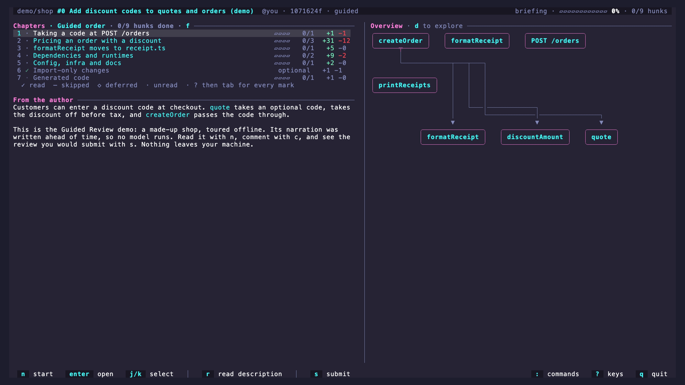

# Guided Review

[](https://www.npmjs.com/package/@haydenmeloche/guided-review)
[](https://github.com/HaydenMeloche/guided-review/actions/workflows/ci.yml)
[](LICENSE)

> **Status:** Guided Review is early (0.x). Expect small bugs, and breaking changes between minor versions.

Guided Review (`gr`) is a TUI for reviewing code changes through a tour.

Traditionally, code is reviewed file by file in alphabetical order. `gr` creates tours that open with a briefing stating what the change is for, then follow each route, command, or handler through the changed code, with the tests for each hunk sitting beside it. It works on a pull request, on your own branch before you open one, or on uncommitted work.

As you review, you can ask an AI model about any line, generate diagrams of the flow, and write comments that reference files or functions you find by search, then post them as one GitHub review.

An AI model is optional. Without one, the tour is built from static analysis alone and nothing leaves your machine.

<p align="center"></p>

## Installation

### Requirements

- Node 22.13 or newer
- `git`
- The [GitHub CLI](https://cli.github.com/) signed in with `gh auth login`, or a GitHub personal access token
- Optional: an AI model provider, such as an Anthropic or OpenAI API key or a Codex login
- Optional: [ripgrep](https://github.com/BurntSushi/ripgrep), which lets the model search your repository

`gr` runs on macOS and Linux, including WSL. Native Windows is untested.

### Install

```sh
npm install -g @haydenmeloche/guided-review
guided-review --version # or gr --version for short
```

If `gr` runs something else, a shell alias is in the way (Oh My Zsh's git plugin defines `gr` as `git remote`), so use `guided-review` instead.

### Getting started

To learn `gr` before touching a real PR, start with the tutor. It opens a sample tour and walks you through it one key at a time. It takes about five minutes, works offline, and posts nothing.

```sh
guided-review tutor
```

Or start right away. The first run walks you through setup (color theme, model, and GitHub access), then lists the PRs waiting for your review.

```sh
guided-review   # or gr
```

If something isn't working, `guided-review doctor` checks your setup.

## Documentation

The full documentation is at **[haydenmeloche.github.io/guided-review](https://haydenmeloche.github.io/guided-review/)**:

- [Install and set up](https://haydenmeloche.github.io/guided-review/install.html)
- [Using Guided Review](https://haydenmeloche.github.io/guided-review/usage.html): every screen, key, command, and option
- [Configuration](https://haydenmeloche.github.io/guided-review/configuration.html): model providers, GitHub access, and themes
- [Team configuration](https://haydenmeloche.github.io/guided-review/repo-config.html), [Share tours from CI](https://haydenmeloche.github.io/guided-review/ci.html), [Privacy and security](https://haydenmeloche.github.io/guided-review/security.html), and [Terminals](https://haydenmeloche.github.io/guided-review/terminals.html)

## Contributing

Issues and pull requests are welcome. For anything larger than a small fix, open an issue first so we can agree on the approach.

```sh
pnpm dev review 1234   # run TypeScript directly, with its own config and db in .gr-dev/
pnpm check             # lint, format check, typecheck, unit tests, and end-to-end tests
```

See [ARCHITECTURE.md](ARCHITECTURE.md) for how the code fits together, and report security issues privately as described in [SECURITY.md](SECURITY.md).

## License

[MIT](LICENSE)
