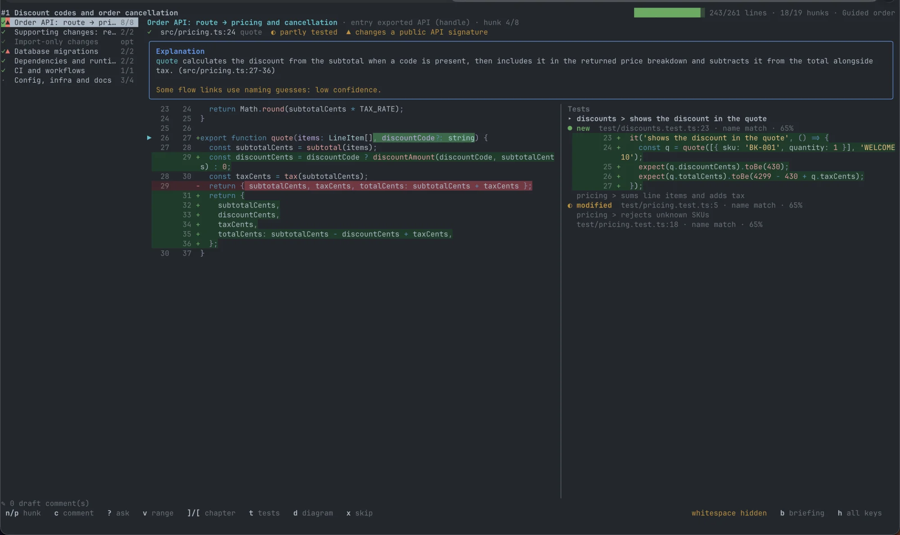
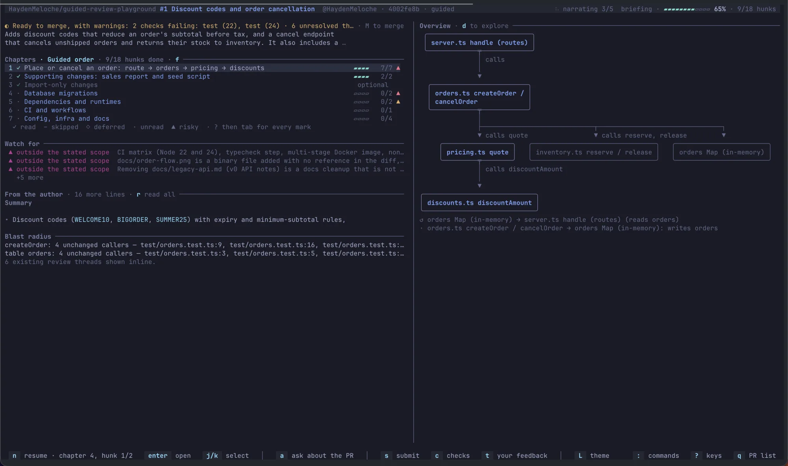
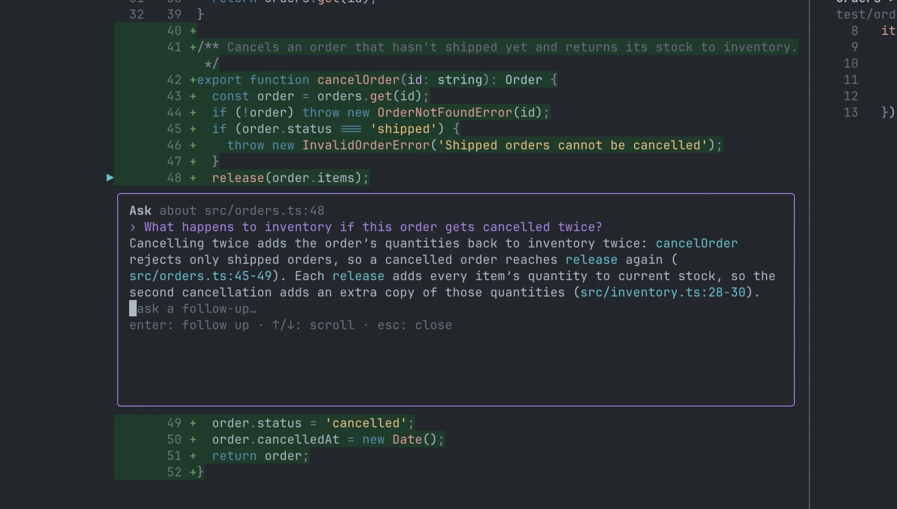

# Guided Review

[](https://www.npmjs.com/package/@haydenmeloche/guided-review)
[](https://github.com/HaydenMeloche/guided-review/actions/workflows/ci.yml)
[](LICENSE)

> **Status:** Guided Review is early (0.x). Expect small bugs, and breaking changes between minor versions.

Read a code change the way the code runs, in your terminal.

A diff lists files alphabetically. Code runs from an entry point through the functions it calls. Guided Review (`gr`) turns a change into a tour that follows that path: a briefing says what the change is for, chapters walk each route, command, or handler through the changed code, and the tests for each hunk sit beside it. It works on a pull request, on your own branch before you open one, or on uncommitted work. You mark what you've read, ask a model about any line, and post your comments as one GitHub review.

The same tour works for learning a codebase: every change becomes a walk through real code, with the tests that pin it down and answers that cite files and lines.

The tour is built from static analysis of the diff and the checkout. A model, if you configure one, adds the briefing's summary, each chapter's explanation, and answers to your questions. Without one, everything else still works, and nothing leaves your machine.

<p align="center"></p>

## Features

**The tour**

- **A tour instead of a file list.** Chapters follow entry points such as routes, commands, and handlers through the changed code, in a recommended reading order. Sort by risk, size, or file instead when you prefer.
- **Changes explained by what they mean.** Migrations, API contracts, dependency and runtime upgrades, lockfiles, infrastructure, and CI each get [their own chapter](docs/usage.md#change-aware-chapters) that covers impact: what a migration locks or drops, which API changes break clients, what a workflow can now do.
- **Tests beside the code.** Linked test cases appear next to the hunks they exercise, and [possible test gaps](docs/usage.md#tests-risk-and-review-prompts) are flagged.
- **Ask questions.** Ask about a selected line, a chapter, or the whole PR without leaving the review. The model can read the rest of the repository, and follow-ups keep the thread: "what calls this?", "why a mutex here?", "where is this tested?".

**Your review**

- **Draft, then submit once.** Comments stay local until you [post them as a single GitHub review](docs/usage.md#draft-and-submit-comments), with code suggestions, `@` mentions, and `@` code references that post as links to the exact lines. AI can draft a suggestion for you to accept.
- **Track your progress.** Hunks are marked read, skipped, or deferred, and that state survives a new push.
- **Re-review after a push.** See only the hunks that changed since your last pass, and check whether your earlier comments were addressed. See [Review after a new push](docs/usage.md#review-after-a-new-push).
- **Preview your own branch.** Tour your branch before you open a PR, to see your change the way a reviewer will.
- **Respond to a review.** `gr feedback` turns the feedback on your own PR into a work list: threads grouped by the code they are on, change requests first, outdated threads followed to where their lines are now, and threads your latest push probably addressed marked. Triage each one, queue replies (AI can draft them), copy a thread as a prompt for your coding agent, answer review summaries in the PR's conversation, then send every reply as one review and ask for another look. See [Respond to a review](docs/usage.md#respond-to-a-review).
- **Merge when it's ready.** The picker and briefings say whether a PR can merge and what blocks it. `M` merges with any method the repository allows, or updates a branch that is behind its base, with a commit message the model drafts. `c` lists the PR's checks and reads a failing job's log. See [Merge a PR](docs/usage.md#merge-a-pr).

**Works with**

- **Your model.** Claude Code, the Anthropic API, Codex, Cursor, OpenAI, any OpenAI-compatible endpoint, Bedrock, or Vertex, or no model at all. See [Configuration](docs/configuration.md).
- **Your CI.** A GitHub Action builds the tour once and posts it to the PR, so reviewers open it without their own model calls. See [Share tours from CI](docs/ci.md).
- **Your terminal.** Keep its colors or choose from 65 [themes](docs/configuration.md#color-themes), dark and light.

## Quick start

```sh
npm install -g @haydenmeloche/guided-review
gr   # the first run walks you through setup, then lists PRs awaiting your review
```

You need Node 22.13 or newer, `git`, and the [GitHub CLI](https://cli.github.com/) signed in with `gh auth login` (or a [personal access token](docs/configuration.md#github-access)). A model is optional. If `gr` runs something else, a shell alias is shadowing it: Oh My Zsh's git plugin defines `alias gr='git remote'`. Use `guided-review`, which the package also installs, or `unalias gr` in your shell config.

## A quick tour

The **briefing** opens first. It shows the PR's intent and author description, recent reviewer feedback, flagged gaps, an overview diagram, and chapters in a recommended reading order. Press `Enter` on a chapter, or `n` to start or resume.

<p align="center"></p>

A **chapter** shows an explanation, the code hunk, risk and test status, existing review threads, and linked tests. Press `n`/`p` to move between hunks, `c` to draft a comment, and `s` to review and submit your drafts.

Press `?` on a selected line or range to ask about it. Answers cite the files and lines they come from, including code outside the diff. Below, the model finds that cancelling an order twice restocks its items twice, by following `release` into a file the PR does not touch.

<p align="center"></p>

## Commands

```sh
gr                            # choose from PRs awaiting your review
gr review 1234               # PR number in the current repository
gr review https://github.com/owner/repo/pull/1234
gr review owner/repo#1234
gr review                    # current branch's open PR
gr feedback                   # work through the review feedback on your PR
gr preview                   # tour the current branch before opening a PR
gr open 1234                 # open a tour in a new tmux or Terminal window
gr build 1234 --comment      # build a tour without the TUI and post it to the PR (for CI)
```

Guided Review checks out the PR head in a detached worktree under `~/.guided-review/worktrees/`, so your own working checkout is left alone. See [Using Guided Review](docs/usage.md) for the picker, every key, commenting, and the [full command and option reference](docs/usage.md#commands-and-options).

## Install

### Requirements

- Node 22.13 or newer (Guided Review uses the built-in `node:sqlite`)
- `git`
- The [GitHub CLI](https://cli.github.com/) (`gh`), signed in with `gh auth login`, or a GitHub [personal access token](docs/configuration.md#github-access)
- [ripgrep](https://github.com/BurntSushi/ripgrep) (`rg`), optional; the model's `search_repo` tool needs it
- A model provider, optional; see [Configure a model](#configure-a-model)
- An interactive terminal; `gr` does not run through a pipe
- macOS or Linux, including WSL. Native Windows is untested.

### From npm

```sh
npm install -g @haydenmeloche/guided-review
```

This puts `gr` and `guided-review` on your `PATH`.

### From source

```sh
git clone https://github.com/HaydenMeloche/guided-review.git
cd guided-review
pnpm install
pnpm build
pnpm add -g .
```

If pnpm's global binary directory is not on your `PATH`, run `pnpm setup` once and restart your shell.

### Configure a model

The first run walks you through setup: a color theme, a model provider, and GitHub access. It finds what your machine already has, such as a Codex login or an `ANTHROPIC_API_KEY`, and tests each model before saving. Run `gr config` to go through it again. An Anthropic, OpenAI, or Cursor API key is the fastest choice; Codex works from your Codex CLI login with no key. With Claude models, setup runs summaries and narration at low effort to keep tours quick; Q&A uses the model's default. To review without AI, choose **No AI model** in setup, or pass `--no-agent` for one review. See [Configuration](docs/configuration.md) for every provider, compatible endpoints, Bedrock, Vertex, and GitHub tokens.

### Use from Claude Code or Codex

`gr install-claude-command` adds a `/guided-review` command to Claude Code, and `gr install-codex-skill` adds a skill to Codex. Both preview your local changes in a new terminal window. See [Use from Claude Code or Codex](docs/usage.md#use-from-claude-code-or-codex).

## Team configuration

Run `gr config --repo` inside a repository to create or edit `.guided-review.json` at the repository root, and commit it so everyone reviewing the repository gets the same rules:

```json
{
  "kinds": [{ "pattern": "src/gen/**", "kind": "generated" }],
  "testPatterns": ["**/*.it.ts"],
  "checklists": [{ "pattern": "db/**", "items": ["Migrations are reversible"] }]
}
```

`kinds` overrides file classification, `testPatterns` adds test-file globs, and a checklist applies when a changed path matches its pattern. The file is read from the PR's merge base, so a PR cannot reclassify its own files. See [Repository configuration](docs/repo-config.md) for the full reference and [docs/examples](docs/examples) for sample configs.

## Privacy and security

Guided Review has no telemetry and runs no server of its own. PR content and any files the agent reads go only to the model provider in your config (nothing, with no model configured or `--no-agent`), and it writes to GitHub only when you act: post a review, reply, react, resolve a thread, ask for a review, update a branch, or merge, each after you confirm it. PR content is treated as untrusted: agent tools are read-only and confined to the PR worktree. See [Data, privacy, and security](docs/security.md) for the details, and [SECURITY.md](SECURITY.md) to report a vulnerability.

## Documentation

- [Using Guided Review](docs/usage.md): the picker, briefing, chapters, keys, comments, re-reviews, responding to a review, merging, and every command and option
- [Configuration](docs/configuration.md): model providers, GitHub access, and `config.json`
- [Share tours from CI](docs/ci.md): the GitHub Action and shared tours
- [Repository configuration](docs/repo-config.md): `.guided-review.json` for teams
- [Data, privacy, and security](docs/security.md): what is sent where, local data, and the security model
- [Architecture](ARCHITECTURE.md): how the code fits together

## Contributing

Issues and pull requests are welcome. For anything larger than a small fix, open an issue first so we can agree on the approach.

```sh
pnpm dev review 1234   # run TypeScript directly, with its own config and db in .gr-dev/ (pnpm reset:db clears it)
pnpm check             # lint, format check, typecheck, unit tests, and end-to-end tests, as CI runs them
```

Use the Node version in `.nvmrc` (22.13, the minimum supported). CI runs the same checks on macOS and Linux, on Node 22.13, 22, 24, and 26. See [ARCHITECTURE.md](ARCHITECTURE.md) for how the code fits together and how the tests work, and report security issues privately as described in [SECURITY.md](SECURITY.md).

## License

[MIT](LICENSE)
